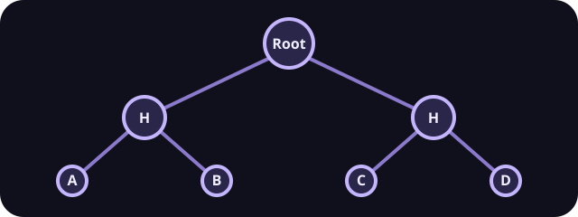

<div align="center">


<p><strong>A local visual explorer for Merkle roots and inclusion proofs.</strong></p>
   
<br/>
</div>

## 🧭 Overview
Merkle Tree Playground hashes each text line as a leaf, combines pairs into parent hashes, and produces a SHA-256 root. Select a leaf to generate and verify its inclusion proof.

## ✨ Features
- 🌳 Build a binary Merkle tree from local text.
- 🔐 Use SHA-256 with domain-separated leaf and parent prefixes.
- 🧾 Generate sibling paths for individual leaves.
- ✅ Verify proofs against the displayed root.
- 🔒 Keep all source values in the browser.

## 🎬 Demo
Start the app; five sample leaves are loaded. Select a leaf index and verify its proof. Change one value and rebuild to see the root change.

## 🚀 Quick Start
Requires Node.js 20 or newer and a browser with Web Crypto support.

```bash
npm start
```

Open http://127.0.0.1:4179. Run checks with npm test.

## 🧰 Tech Stack
- 🟢 Node.js built-in HTTP server
- 🌐 Browser Web Crypto API and JavaScript modules
- 🧪 Node.js built-in test runner

## 🗂️ Folder Structure
```text
public/       Merkle builder, proof logic, and interface
test/         Root and inclusion-proof tests
assets/       Original SVG artwork
.github/      CI workflow
server.js     Dependency-free static server
```

## 🛣️ Roadmap
- [ ] Add proof export as JSON.
- [ ] Show each intermediate hash level.
- [ ] Support binary file leaves with explicit size limits.

## 🤝 Contributing
Contributions are welcome. Preserve domain separation between leaves and parent nodes, and add tests for odd leaf counts and tampered proofs.

## 📄 License
MIT. See LICENSE.

<div align="center"></div>
